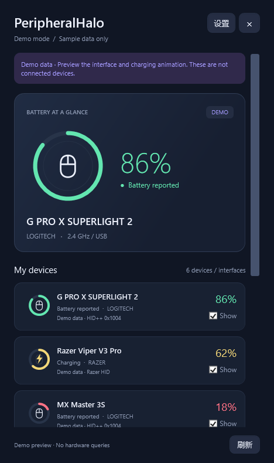

# PeripheralHalo

A Windows 11 system-tray app for checking wireless mouse, headset, and keyboard battery levels. Each tray icon uses a device glyph inside a colored battery ring, keeping peripheral battery status separate from the Windows battery indicator.

[简体中文](README.md) · English



## Features

- View battery percentage and charging state at a glance from the system tray.
- Open the panel for device names, connection state, battery source, and per-device visibility controls.
- Choose Chinese or English in **Settings → Language**. The selection is saved on this PC.
- Use animated charging feedback, low-battery alerts, and a configurable 15 / 30 / 60 / 120 second refresh interval.
- Preview the interface with clearly marked sample devices. Demo mode never queries hardware.

Battery rings use green at 75–100%, yellow at 50–74%, orange at 21–49%, and red at 0–20%. Unknown values appear in gray. Voltage-based readings are marked as estimates.

## Download and run

Download `PeripheralHalo-1.1.0-Windows-x64.zip` from [GitHub Releases](https://github.com/Barsolid/PeripheralHalo/releases), extract it, and run `PeripheralHalo.exe`. No installer, SDK, administrator rights, Logitech G HUB, or Razer Synapse are required. Windows 11 includes the .NET Framework 4.8 runtime used by the app.

Click a tray ring to open the device panel. Select **Show** beside a device to pin its ring in the system tray. Windows may place new icons in the hidden-icons menu (`^`); use Windows taskbar settings to keep them visible. Right-click a ring to open the panel, refresh readings, open settings, or exit. Closing the panel hides it while the app continues running.

## Device support

Peripheral battery protocols vary by model, receiver, firmware, and connection mode. The list below describes implemented protocol paths; it does not mean every listed product has been verified on physical hardware.

| Device family | Implemented support | Verification |
| --- | --- | --- |
| Logitech LIGHTSPEED, Unifying, and Bolt mice and keyboards | HID++ 2.0 battery and status features; receiver slots and directly connected devices | Protocol implementation; verify with each model |
| Older Logitech wireless devices | HID++ 1.0 coarse battery-level fallback | May report only approximate levels |
| Selected Logitech headsets | HID++ voltage/charging information; Logitech G PRO X 2 receiver path | Voltage readings are estimates; model coverage varies |
| Selected Razer wireless mice and keyboards | 68 mouse and 13 keyboard PID profiles; read-only battery and charging reports | Razer DeathAdder V3 Pro was physically verified in an earlier release |
| Razer BlackShark V2 Pro (2020 / 2023) and Barracuda Pro | Dedicated headset protocols | Protocol fixtures and simulated receiver tests; not physically verified here |
| Logitech G435 over LIGHTSPEED | Receiver identification and limitation guidance | Exact battery percentage and charging state are not supported |
| Bluetooth headsets that publish Windows HFP battery data | Reads the current connected device's Windows battery property | Depends on what Windows and the headset report; charging state is unavailable |

This is not a promise of support for every Logitech or Razer product. Unsupported interfaces and missing readings remain unknown; the app does not invent a percentage or reuse stale battery values. A connected receiver alone does not prove that its wireless device is online.

The G435 LIGHTSPEED receiver path does not currently provide a reliable exact battery reading in this app. Logitech's headset LED indicates green at 31–100%, red at 15–30%, and flashing red below 15% ([Logitech support](https://support.logi.com/hc/en-ph/articles/4409384013591-Check-the-battery-level-of-your-G435)). In Bluetooth mode, a Windows HFP battery value may be available, but it does not include charging state and has not been verified with the G435 here.

See [the complete PID profile list](docs/compatibility.md), [protocol notes](docs/protocols.md), and [version 1.1 support notes](docs/upgrade-1.1.md).

## Settings and privacy

Settings are stored in `%LOCALAPPDATA%\PeripheralHalo\settings.json`. The app does not connect to the internet or upload device information. It does not change DPI, lighting, pairing, or firmware. Some headset protocols briefly open and release a communication session to read battery status.

Diagnostic export is saved only to a location you choose. It contains USB vendor/product IDs, model names, interface capabilities, and readings; it excludes serial numbers, Bluetooth addresses, and full device paths. Review the file before sharing it. Windows may show an unknown publisher warning because the portable executable is unsigned.

## Build

On Windows x64, run in PowerShell:

```powershell
.\build.ps1
.\dist\PeripheralHalo.exe
```

The build uses the Windows .NET Framework C# compiler and does not download NuGet packages. GitHub Actions builds the app and runs protocol tests on Windows.

Developer options:

```powershell
# Start with clearly labeled sample readings; do not query hardware
.\dist\PeripheralHalo.exe --demo

# Start minimized to the system tray
.\dist\PeripheralHalo.exe --background

# Run protocol checks and write their report
.\dist\PeripheralHalo.exe --self-test test-results.txt

# Query supported devices and write a local diagnostic report
.\dist\PeripheralHalo.exe --diagnose diagnostics.txt
```

## License

PeripheralHalo is distributed under GPL-2.0-only. See [LICENSE](LICENSE) and [third-party notices](THIRD_PARTY_NOTICES.md).
