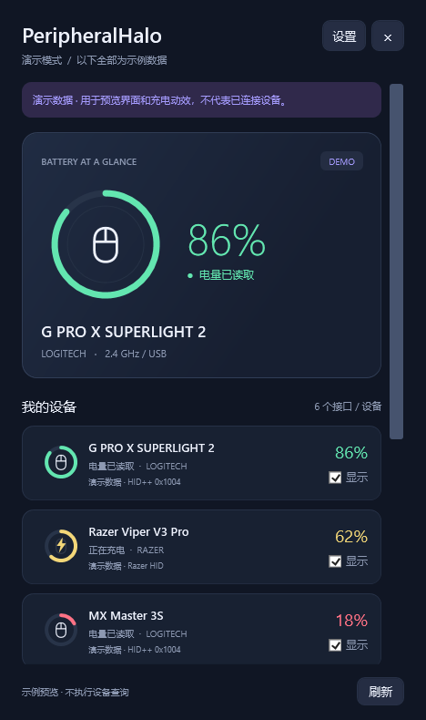

# PeripheralHalo · 外设光环

Windows 11 无线外设电量托盘应用。用一个带设备图标的圆环，看清鼠标、耳机与键盘的剩余电量。



## 1.1 更新：耳机与键盘

新增雷蛇 **13 个无线键盘/线缆 PID** 的电量与充电读取；新增 **BlackShark V2 Pro 2020 / 2023、Barracuda Pro** 耳机协议；新增罗技 **G PRO X 2 Centurion**，并完善 G535 等耳机接口选择。原有罗技键盘自动适配保留。

详见 [1.1 支持范围与限制](docs/upgrade-1.1.md)。这些是协议实现与测试结果，**不代表全部型号均经过本机实测**。G435 LIGHTSPEED 仍不支持精确电量；Nari、Kraken、BlackShark V3 等其他耳机协议仍未覆盖。

## 使用

从 [Releases](https://github.com/Barsolid/PeripheralHalo/releases) 下载 `PeripheralHalo-1.1.0-Windows-x64.zip`，解压后双击 `PeripheralHalo.exe`。不需要安装 SDK 或管理员权限，Windows 11 自带所需的 .NET Framework 4.8。

- 点击右下角圆环，查看设备名称、电量、充电状态及读数来源。
- 勾选设备旁的「显示」，选择哪些设备在系统托盘显示。支持同时显示多个设备。
- 新图标可能位于托盘的 `^` 菜单内。将其拖到任务栏，或在 Windows 任务栏设置中启用显示。Windows 决定图标是否折叠，应用不会强制修改系统设置。
- 右键圆环可以打开面板、刷新、进入设置或退出。
- 点击面板的 `×` 或按 Esc 只隐藏窗口，应用继续在托盘运行；「设置 → 退出应用」结束程序。
- 可设置 15 / 30 / 60 / 120 秒轮询、低电量提醒、动画、登录时启动。默认 30 秒，默认不修改开机启动。
- 新配对的接收器子设备可点击「刷新」立即重新探测；已缓存的罗技设备特性每五分钟重新探测。

## 显示规则

| 电量 | 颜色 |
| --- | --- |
| 75–100% | 绿色 |
| 50–74% | 黄色 |
| 21–49% | 橙色 |
| 0–20% | 红色 |
| 未知 | 灰色，显示 `—` |

圆环中间显示鼠标、耳机、键盘或通用设备图标。充电时，设备图标与闪电通过呼吸动画交替浮现；动画可关闭，也遵循 Windows 的动画设置。估算百分比用 `≈` 标注，并注明电压或电量档位来源。

## 设备适配与真实限制

**本机实测通过：Razer DeathAdder V3 Pro，USB PID `1532:00B7`，读取到电量与充电状态。** 其余型号属于协议实现范围，未经逐台实机验证。

| 设备范围 | 实现方式 | 验证情况 |
| --- | --- | --- |
| 罗技 LIGHTSPEED / Unifying / Bolt 鼠标、键盘 | HID++ 2.0 特性自动发现：`0x1004`、`0x1000`、`0x1001`；接收器槽位 1–6 及直接设备 `FF` | 协议已实现，需按设备验证 |
| 较老的罗技无线设备 | HID++ 1.0 电量寄存器 `0x0D` / `0x07` 回退 | 可能仅有粗略档位，需按设备验证 |
| 部分罗技耳机 | HID++ `0x1F20` 电压及充电标志 | 电压百分比为估算；另有 G PRO X 2 0AF7 的 Centurion 适配 |
| 雷蛇无线鼠标与部分无线键盘 | 68 个鼠标 PID + 13 个键盘 PID 配置；只读电量 `07/80`、充电 `07/84`，逐型号 transaction ID | DeathAdder V3 Pro 已实测；[完整配置列表](docs/compatibility.md) |
| 雷蛇部分无线耳机 | BlackShark V2 Pro 2020 / 2023、Barracuda Pro 专用协议 | 协议样本与模拟接收器测试通过，尚未本机实测 |
| 罗技 G435 · LIGHTSPEED | 接收器识别、型号及限制说明 | **当前版本不能显示精确电量或充电状态** |
| 罗技 G435 等蓝牙 HFP 耳机 | 读取 Windows 电量属性，并通过系统蓝牙 API 确认当前连接 | 已实现，**G435 蓝牙未实机验证**；取决于 Windows 是否发布电量 |

**无法承诺罗技与雷蛇的所有设备都能读取。** 同系列不同硬件版本、不同接收器、固件和驱动都可能不同。未知型号会显示接口及原因，不会伪造电量或用历史电量冒充实时读数。USB 接口/接收器存在不等于无线设备在线。USB 读取失败后会清空该次电量，而不是继续显示旧数据。

G435 的 LIGHTSPEED 通道没有在本项目中实现可靠的百分比读取。官方提供的查看方式是：耳机开机后短按电源键，绿灯 31–100%、红灯 15–30%、闪红灯低于 15%。[罗技官方说明](https://support.logi.com/hc/en-ph/articles/4409384013591-Check-the-battery-level-of-your-G435)。蓝牙模式若 Windows 上报电量，应用可通过 HFP 读取；该属性不提供充电状态，且数值更新速度由耳机与 Windows 决定。

## 编译与测试

在 Windows x64 的 PowerShell 中运行：

```powershell
.\build.ps1 -Test
.\dist\PeripheralHalo.exe
```

使用 Windows 自带的 .NET Framework C# 编译器，不需要下载 NuGet 包。输出位于 `dist/`。GitHub Actions 会在 Windows 上自动编译、运行协议测试并保存构建产物。

开发工具参数：

```powershell
# 显示带有显著标识的演示数据，不查询硬件
.\dist\PeripheralHalo.exe --demo
# 静默在托盘启动
.\dist\PeripheralHalo.exe --background
# 将协议与边界测试结果写到文件（运行后退出）
.\dist\PeripheralHalo.exe --self-test test-results.txt
# 执行只读设备查询，导出本地诊断（运行后退出）
.\dist\PeripheralHalo.exe --diagnose diagnostics.txt
```

测试覆盖分层边界、无效与未知电量、电压曲线、充电解析、雷蛇响应匹配及校验和、81 个鼠标/键盘 PID 配置，耳机协议/离线处理，以及演示数据隔离。协议测试不替代硬件测试。

## 本地设置与隐私

设置位于 `%LOCALAPPDATA%\PeripheralHalo\settings.json`。应用不联网、不上传设备信息，不需要 G HUB / Synapse，不修改外设的 DPI、灯效或固件。部分耳机读取需要短暂申请并释放通讯会话。启用登录时启动只写入当前用户的 Windows Run 项，关闭时会移除该项。

「导出诊断」由用户选择本地保存位置；文件包含 USB VID/PID、型号、接口长度与电量，不包含设备序列号、蓝牙地址或完整设备路径。分享诊断前请自行检查内容。未签名的便携程序可能由 Windows 显示未知发布者。

项目采用 GPL-2.0-only。协议依据与开源归属见 [协议说明](docs/protocols.md) 和 [第三方声明](THIRD_PARTY_NOTICES.md)。
